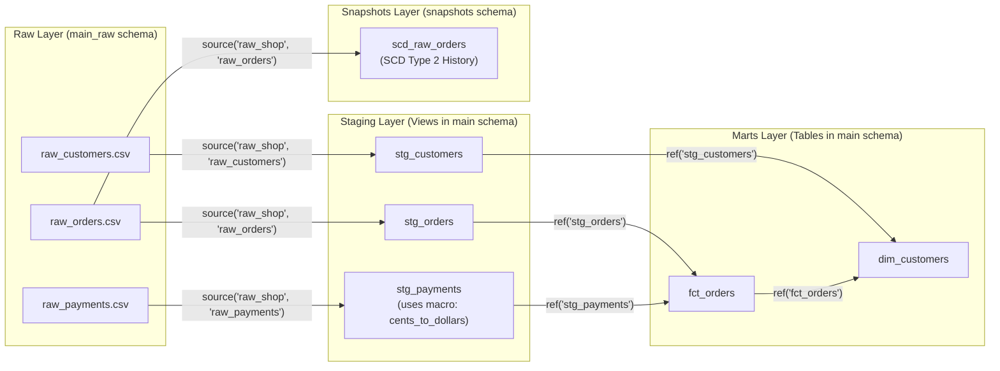

# dbt Core + DuckDB Learning Walkthrough

Welcome to your local **dbt Core (`1.12.6`) + DuckDB (`1.11.1` / `duckdb 2.0.0`)** playground! This guide walks through the mini-project in [`dbt_duckdb_demo/`](./dbt_duckdb_demo/) and explains all of the essential building blocks of dbt.

---

## 1. Architecture & Data Lineage

The project models an e-commerce store (customers, orders, and payments) following dbt's recommended **Raw (Seeds/Sources) → Staging → Marts** layered architecture:



---

## 2. Project Structure & Key dbt Concepts

### A. Project & Connection Configuration
- **[`dbt_duckdb_demo/profiles.yml`](./dbt_duckdb_demo/profiles.yml)** — Tells dbt **how to connect** to your data warehouse. Here it configures the `dbt_duckdb_demo` profile to use `type: duckdb` and write to a local file (`dev.duckdb` for `dev`, `prod.duckdb` for `prod`).
- **[`dbt_duckdb_demo/dbt_project.yml`](./dbt_duckdb_demo/dbt_project.yml)** — Configures project-level defaults:
  - Seeds load into the `raw` (`main_raw`) schema.
  - Models under `models/staging/` default to `+materialized: view` (lightweight, always fresh).
  - Models under `models/marts/` default to `+materialized: table` (fast to query by BI tools and downstream consumers).

---

### B. Seeds (`seeds/`) — Loading CSVs into the Warehouse
Seeds are CSV files in `seeds/` that `dbt seed` loads into your database. They are typically used for static lookup tables (e.g., country codes) or sample raw datasets for local development:
- **[`raw_customers.csv`](./dbt_duckdb_demo/seeds/raw_customers.csv)** — 5 registered customers.
- **[`raw_orders.csv`](./dbt_duckdb_demo/seeds/raw_orders.csv)** — 6 customer orders across `placed`, `shipped`, `completed`, and `returned` statuses.
- **[`raw_payments.csv`](./dbt_duckdb_demo/seeds/raw_payments.csv)** — 7 payment records in cents (`credit_card`, `gift_card`, `bank_transfer`).

---

### C. Sources (`{{ source() }}`) & Staging Models (`models/staging/`)
Staging models are **1-to-1** with raw source tables. Their job is to cast data types, rename columns consistently, and perform simple row-level cleaning—without joins or aggregations:
- **[`models/staging/_sources.yml`](./dbt_duckdb_demo/models/staging/_sources.yml)** — Declares the `raw_shop` source pointing to the `main_raw` schema so models can reference raw tables cleanly via `{{ source('raw_shop', 'raw_orders') }}`.
- **[`models/staging/stg_customers.sql`](./dbt_duckdb_demo/models/staging/stg_customers.sql)** — Casts IDs and signup dates, lowercases email addresses, and concatenates `full_name`.
- **[`models/staging/stg_orders.sql`](./dbt_duckdb_demo/models/staging/stg_orders.sql)** — Casts dates/timestamps and renames `status` to `order_status`.
- **[`models/staging/stg_payments.sql`](./dbt_duckdb_demo/models/staging/stg_payments.sql)** — Converts `amount_cents` into `amount_dollars` using a custom Jinja macro.

---

### D. Jinja & Macros (`macros/`)
dbt lets you use **Jinja** templates (`{{ ... }}` for expressions, `` for control flow/macros) to avoid repeating SQL logic across models:
- **[`macros/cents_to_dollars.sql`](./dbt_duckdb_demo/macros/cents_to_dollars.sql)** — Defines the reusable macro:
  ```sql
  
      round(cast({{ column_name }} as numeric) / 100.0, {{ precision }})
  
  ```
- Used in **[`models/staging/stg_payments.sql`](./dbt_duckdb_demo/models/staging/stg_payments.sql)** as `{{ cents_to_dollars('amount_cents') }} as amount_dollars`.
- **Inspecting compiled SQL:** Whenever dbt runs, it compiles Jinja into pure SQL inside `target/compiled/`. Check **[`target/compiled/dbt_duckdb_demo/models/staging/stg_payments.sql`](./dbt_duckdb_demo/target/compiled/dbt_duckdb_demo/models/staging/stg_payments.sql)** to see the exact SQL sent to DuckDB.

---

### E. Marts (`{{ ref() }}` — Fact & Dimension Tables)
Marts join and aggregate staging models into business-ready entities using `{{ ref('model_name') }}`. Calling `ref()` automatically registers dependencies in dbt's Directed Acyclic Graph (DAG) so models always build in the right order:
- **[`models/marts/fct_orders.sql`](./dbt_duckdb_demo/models/marts/fct_orders.sql)** — Joins `stg_orders` and `stg_payments` to pivot payment amounts by payment method (`credit_card_amount`, `gift_card_amount`, `bank_transfer_amount`) and compute `total_amount_dollars` per order.
- **[`models/marts/dim_customers.sql`](./dbt_duckdb_demo/models/marts/dim_customers.sql)** — Joins `stg_customers` with `fct_orders` to calculate `first_order_date`, `most_recent_order_date`, `number_of_orders`, `lifetime_value_dollars` (excluding returned orders), and segments customers into `VIP`, `Active`, or `Prospect` (`customer_tier`).

---

### F. Data Tests (Generic & Singular)
dbt supports two kinds of automated data quality tests:

1. **Generic (Schema) Tests** — Declared in YAML files using built-in test types (`unique`, `not_null`, `accepted_values`, and `relationships` for referential integrity):
   - **[`models/staging/_stg_models.yml`](./dbt_duckdb_demo/models/staging/_stg_models.yml)** — Verifies primary keys, valid order statuses/payment methods, and foreign key relationships (`stg_orders.customer_id` → `stg_customers.customer_id`).
   - **[`models/marts/_marts_models.yml`](./dbt_duckdb_demo/models/marts/_marts_models.yml)** — Verifies `fct_orders` and `dim_customers` primary keys and `customer_tier` values.
2. **Singular Tests** — Custom SQL queries in `tests/` that return **failing** rows (if the query returns `0` rows, the test passes):
   - **[`tests/assert_positive_order_totals.sql`](./dbt_duckdb_demo/tests/assert_positive_order_totals.sql)** — Ensures no order in `fct_orders` has `total_amount_dollars < 0`.

---

### G. Snapshots (`snapshots/`) — Slowly Changing Dimensions (SCD Type 2)
When a source table overwrites rows in place (for example, `raw_orders.status` changing from `placed` to `shipped`), you lose historical state unless you snapshot it:
- **[`snapshots/scd_raw_orders.sql`](./dbt_duckdb_demo/snapshots/scd_raw_orders.sql)** — Uses `strategy='timestamp'` on `updated_at` with `unique_key='order_id'` to maintain historical versions in `snapshots.scd_raw_orders`, automatically adding `dbt_valid_from` and `dbt_valid_to` columns.

---

## 3. Essential Commands Cheat Sheet

Open your terminal in `/Users/professorshabangu/Documents/dbt_play_ground`:

```zsh
# 1. Activate the Python virtual environment
source .venv/bin/activate

# 2. Move into the dbt project directory
cd dbt_duckdb_demo

# 3. Verify your connection and profile configuration
dbt debug

# 4. Load the raw CSV files from seeds/ into DuckDB (main_raw schema)
dbt seed

# 5. Build all models (views & tables), run snapshots, and execute all tests in DAG order
dbt build

# 6. Run individual steps when iterating:
dbt run                        # Only build models
dbt run --select fct_orders+   # Build fct_orders and everything downstream of it
dbt test                       # Run all data tests
dbt snapshot                   # Run SCD Type 2 snapshots

# 7. Inspect the built DuckDB tables directly using the helper script
python query_duckdb.py

# 8. Generate and view the interactive dbt Documentation & Lineage Graph in your browser
dbt docs generate
dbt docs serve
```

---

## 4. Three Quick Hands-On Exercises to Try

1. **Test SCD Type 2 History with `dbt snapshot`:**
   - Open [`dbt_duckdb_demo/seeds/raw_orders.csv`](./dbt_duckdb_demo/seeds/raw_orders.csv) and change order `106` from `placed,2026-03-10 08:00:00` to `shipped,2026-03-12 15:00:00`.
   - Run `dbt seed && dbt snapshot && python query_duckdb.py`.
   - Look at `snapshots.scd_raw_orders`: order `106` will now have **two rows**—one closed historical row (`status = 'placed'` with `dbt_valid_to = 2026-03-12 15:00:00`) and one current row (`status = 'shipped'` with `dbt_valid_to = NULL`).
2. **See a Data Test Catch Bad Data:**
   - In [`dbt_duckdb_demo/seeds/raw_payments.csv`](./dbt_duckdb_demo/seeds/raw_payments.csv), add a row with a negative payment: `1008,106,credit_card,-5000`.
   - Run `dbt seed && dbt build`. Watch the singular test [`assert_positive_order_totals.sql`](./dbt_duckdb_demo/tests/assert_positive_order_totals.sql) fail and prevent downstream errors!
3. **Explore the Interactive DAG:**
   - Run `dbt docs serve` inside `dbt_duckdb_demo/`.
   - Click the blue **Lineage Graph** icon in the bottom-right corner of the web page to explore your project's full dependency graph.

---

## 5. Official Documentation & Further Reading

- **Core Concepts:**
  - [About dbt Models & Materializations](https://docs.getdbt.com/docs/build/models)
  - [Using `source()`](https://docs.getdbt.com/docs/build/sources) & [Using `ref()`](https://docs.getdbt.com/reference/dbt-jinja-functions/ref)
  - [How We Structure Our dbt Projects (Best Practices Guide)](https://docs.getdbt.com/best-practices/how-we-structure/1-guide-overview)
- **Testing, Jinja & Snapshots:**
  - [Data Tests (`unique`, `not_null`, `relationships`, singular tests)](https://docs.getdbt.com/docs/build/data-tests)
  - [Jinja & Macros in dbt](https://docs.getdbt.com/docs/build/jinja-macros)
  - [Snapshots (Slowly Changing Dimensions)](https://docs.getdbt.com/docs/build/snapshots)
- **DuckDB Adapter:**
  - [dbt-duckdb Adapter Setup & Features](https://docs.getdbt.com/docs/core/connect-data-platform/duckdb-setup) (reading/writing external Parquet/CSV files, S3, and MotherDuck)

